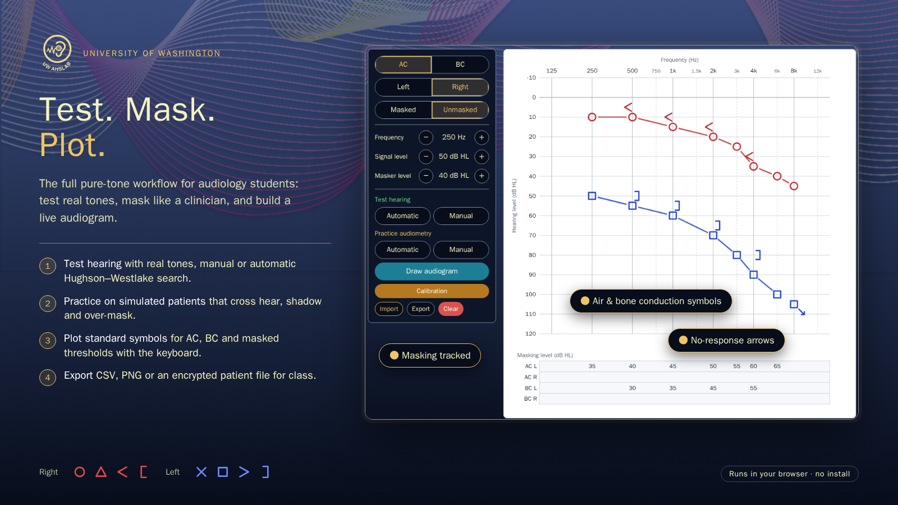

# AHSLAB Audiometric Simulation Suite



A free, browser-based simulator for learning and practicing pure-tone audiometry: air and bone conduction, masking, simulated patients with realistic response variability, and live audiograms. Built with React, TypeScript and Vite.

**[Try the app online](https://faculty.washington.edu/shenyi/AHSLAB_Audiometric_Simulation_Suite/)**.
Your feedback is highly appreciated! Please share suggestions or report issues on the
[GitHub issues page](https://github.com/AHSLab-UW/AHSLab-Audiometric-Simulation-Suite/issues).

`audiometry` · `audiology` · `audiogram` · `hearing-test` · `masking` · `bone-conduction` · `education`

## Features

- **Test hearing** – present real tones (air conduction, optional narrow-band masking noise in the opposite ear) and record thresholds, either with the manual controls or the automatic threshold search.
- **Practice audiometry** – test a simulated patient (built-in samples or an encrypted `.txt` file) that models cross hearing, masking and over-masking.
- **Generated practice patients** – unlimited, realistic, seeded cases (common or tricky: otosclerosis, asymmetric loss, dead ear, masking dilemma, …) with a short case history and the patient's self-reported better ear. When you press Done, a non-graded review shows your audiogram next to the true one, the recommended test sequence (start ear, masking decisions) and notes on your results.
- **Draw audiogram** – plot results directly with standard symbols (O/X, △/□, `<` `>`, `[` `]`, no-response arrows).
- **Import / export** – CSV, encrypted `.txt` (usable as a simulated patient) and PNG.
- **Calibration** – a 1 kHz tone for setting the system volume.

### Keyboard shortcuts (manual / draw modes)

| Key | Action |
| --- | --- |
| Space | Present tone (manual mode) |
| ← → | Change frequency |
| ↑ ↓ | Change level (5 dB steps) |
| Enter | Record threshold |
| Backspace | Delete the mark at the current frequency/ear/conduction/masking |
| D | Done |
| C / M / E / R | Draw mode: cycle AC/BC, masking, ear, response |

## Manuals

- [Student manual](docs/STUDENT_MANUAL.md) – screen tour, modes, shortcuts, masking method, practice checklist.
- [Instructor manual](docs/INSTRUCTOR_MANUAL.md) – deployment, activities, creating simulated patients, model assumptions and limitations.

## Development

Requires Node.js 20 or later.

```
npm install
npm run dev        # start the dev server
npm test           # unit tests (Vitest)
npm run lint       # ESLint
npm run build      # type-check and build to dist/
```

### Layout

- `src/audio` – tone and noise synthesis, FFT, Web Audio playback
- `src/model` – marks, CSV/encryption, simulated listener, automatic exercise (pure, unit-tested)
- `src/components` – audiogram SVG, control panel, dialogs
- `src/useAudiometer.ts` – application state and keyboard handling
- `public/audiograms` – sample patients

## License

Released under the [MIT License](LICENSE).

## Contributing

Fork, branch from `master`, make your change, run `npm run lint && npm test && npm run build`, and open a pull request.

## References and branding

See [REFERENCES.md](REFERENCES.md) for the sources behind the simulation model, audiogram symbols, and the AHSLab branding credits.

## Simulated-client variability (validation)

The simulated listener answers probabilistically (logistic psychometric function, 50% at the true
threshold, 10–90% spread of about 4.4 dB) so repeated measurements of the same client differ, as
in practice. Seeded tests in `src/model/model.test.ts` check:

- ≈50% "yes" at threshold (20,000 trials), <1% at −10 dB, >99% at +10 dB;
- response probability rises monotonically with level;
- 500 automatic searches (start 30 dB, true threshold 45 dB HL, ASHA 2005 rule) all terminate,
  with mean 47.7 dB HL (+2.7 dB bias, typical of ascending-method thresholds) and SD 2.5 dB,
  (see the sweep below for the full range).

Run with `npm test`. The slope and variability are teaching assumptions, not fitted to patient data.

### Range × conduction × masking sweep

`src/model/validation.test.ts` runs the automatic search (start 30 dB HL, ASHA 2005 rule) 2 × 400 times
per condition at 500 and 2000 Hz. The test ear is the right ear, with true thresholds of 0–100 dB HL (AC)
or 0–70 dB HL (BC); the left ear is normal (5 dB HL). Scenarios: AC unmasked, AC masked, AC unmasked with
a 30 dB air-bone gap, BC unmasked, BC masked, and BC masked with a 30 dB air-bone gap. Masked runs use a
masker in the middle of the plateau. Run `npx vitest run src/model/validation.test.ts --silent=false`
for the full table.

| Condition | Bias vs true threshold | SD of one search | Test–retest SD | Test–retest 95% limit |
|---|---|---|---|---|
| Unmasked, no cross hearing (AC ≤ 40 dB HL; BC at the better cochlea) | +2.4 to +3.2 dB | 2.4–2.5 dB | 3.3–3.7 dB | ±6.4 to ±7.4 dB |
| Masked on the plateau (AC and BC) | +7.3 to +7.6 dB | 2.5 dB | 3.4–3.7 dB | ±6.8 to ±7.5 dB |

How to read the bias:

- **About +3 dB unmasked** is the ascending-method bias: the rule settles on the first level at which the
  client responds twice on ascending trials, which sits above the 50% point of the psychometric function.
- **About +7.5 dB masked** is that same ~2.5 dB plus the modelled 5 dB central-masking shift.
- **Large negative bias is intended, not an error.** Unmasked AC with a true threshold of 50 dB HL or worse
  (and a normal better ear) returns about 45 dB HL. Cross hearing (40 dB interaural attenuation plus the
  better ear's 5 dB BC) produces the shadow curve: bias is about −12 dB at 60 dB HL and −52 dB at 100 dB HL.
  Unmasked BC responds from the better cochlea (5 dB HL), so a poorer true BC threshold is not recovered
  until it is masked. This is what students should learn to identify and mask.
- Scatter does not depend on threshold, frequency, conduction or masking, because the same logistic
  response function is used everywhere.

Expected reliability: a single search has SD ≈ 2.5 dB around its long-run mean, and two repeats differ by
about 3.5 dB SD (95% of pairs within about 7 dB). That is somewhat noisier than the ±5 dB test–retest
reliability commonly quoted for manual audiometry (not verified here; I had no literature access), so treat
the simulated client as slightly less consistent than a typical cooperative adult. To tighten it, make the
psychometric slope in `respond()` steeper. The tests assert SD < 5 dB, 95% test–retest limit < 10 dB, and
bias within 5 dB of the model-expected threshold in every condition.
